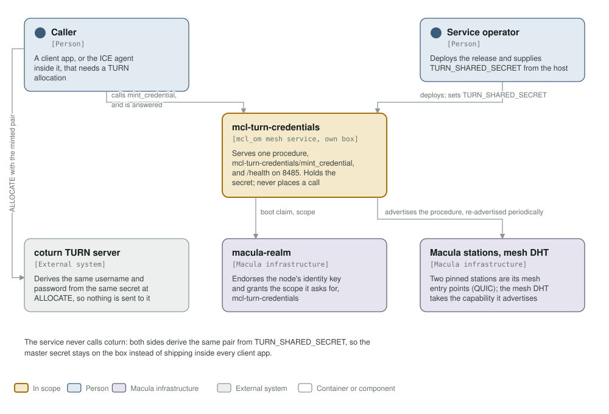
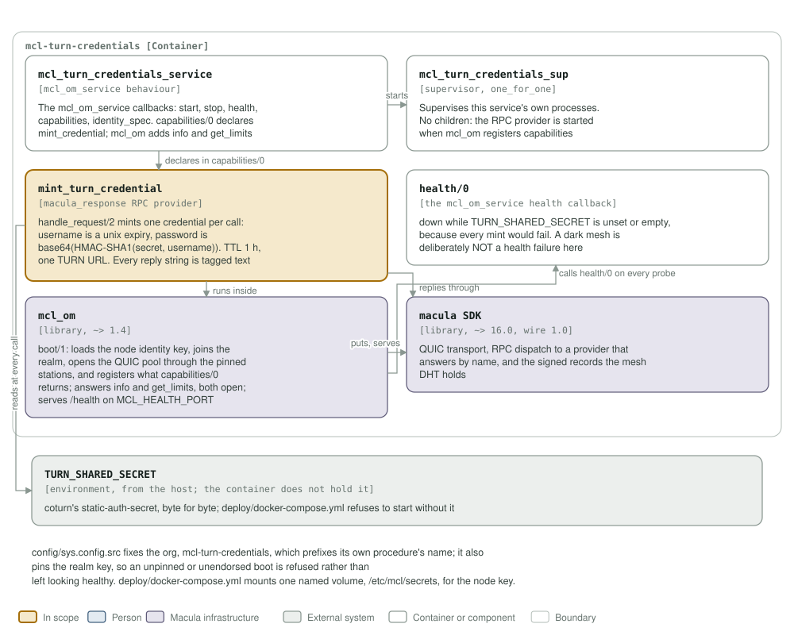

# mcl-turn-credentials architecture: C4 model

*This exists so a reader can see what mcl-turn-credentials talks to, and what it is
made of, without reading it.*

**Status: `mcl-turn-credentials/mint_credential` is the service's own procedure,
and the only one.** The service boots, joins the mesh, advertises it under `open`
auth, and answers `/health` on 8485. `mcl_om` adds
`mcl-turn-credentials/info` and `mcl-turn-credentials/get_limits` to every
service, open to any caller; `capabilities/0` is the list. It holds the TURN shared secret
and mints credentials from it. It places no calls of its own: the boot claim and
the realm join are `mcl_om`'s. It keeps no store.

## Level 1: system context

| Element | Kind | Role |
| --- | --- | --- |
| mcl-turn-credentials | In scope | Serves `mcl-turn-credentials/mint_credential` and `/health` on 8485. One OTP release in one container, an `mcl_om` mesh service |
| Caller | Person | A client app, or the ICE agent inside it, that needs a TURN allocation and cannot be trusted with the master secret |
| Service operator | Person | Runs the box, deploys the release, and supplies `TURN_SHARED_SECRET` from the host |
| macula-realm | Macula infrastructure | Endorses the node's identity key and grants a provider authorization per org procedure, its own `mint_credential` and the open `info` and `get_limits` included. Without that grant `/health` reads degraded |
| macula stations, mesh DHT | Macula infrastructure | The service dials out to the pinned stations; the mesh DHT takes the endpoint it announces |
| coturn TURN server | External system | Derives the same username and password from the same secret at ALLOCATE, so nothing is sent to it and it needs no call from this service |

The service never calls coturn. Both sides compute `base64(HMAC-SHA1(secret,
username))`, so the pair agrees without a round trip, and the master secret stays
on the box instead of shipping inside every client app.

## Level 2: containers and components

| Component | Technology | Responsibility |
| --- | --- | --- |
| `mcl_turn_credentials_service` | Erlang, the `mcl_om_service` behaviour | The six callbacks `mcl_om` resolves by name at startup: `info/0`, `start/1`, `stop/1`, `health/0`, `capabilities/0`, `identity_spec/0` |
| `mcl_turn_credentials_sup` | supervisor, `one_for_one` | Owns this service's processes. No children: the RPC provider is started when `mcl_om` registers capabilities, so an empty child list is the honest shape, not a placeholder |
| `mint_turn_credential` | `macula_response` RPC provider | `handle_request/2` mints one credential per call: a unix expiry as the username, the HMAC as the password, `ttl_seconds` 3600 and one TURN URL. Every reply string is tagged text, because a bare binary reaches non-BEAM callers as 0x-hex |
| `health/0` | the `mcl_om_service` health callback | `down` while `TURN_SHARED_SECRET` is unset or empty, because every mint would fail. A dark mesh is deliberately not a health failure |
| `mcl_om` | library, `~> 1.4` | `boot/1`: loads the node identity key, joins the realm, opens the QUIC pool through the pinned stations, registers what `capabilities/0` returns and serves `/health` |
| macula SDK | library, `~> 16.0`, wire 1.0 | QUIC transport, RPC dispatch to a provider that answers by name, and the signed records the mesh DHT holds |
| `TURN_SHARED_SECRET` | environment, from the host | coturn's `static-auth-secret`, byte for byte. The compose file refuses to start without it |

`config/sys.config.src` fixes the org, `mcl-turn-credentials`, which prefixes its
own procedure's name, and pins the realm key. `mcl_om` refuses to boot without the
realm, the realm key and pinned station seeds, naming each one missing; a node the
realm has not endorsed still boots, and its `/health` reads degraded instead.
`deploy/docker-compose.yml` mounts one named volume, `/etc/mcl/secrets`, and the
node identity key lives there: without it the service cannot sign, so it does not
come up on the mesh.

**Where the station list comes from.** It is not in `config/sys.config.src`: `mcl_om` reads `MACULA_STATION_SEEDS` and `MACULA_STATION_NODE_IDS` from the environment at boot, paired index for index, so this repository pins no station and the list may be any length.

## Drawing them

`assets/c4-context.svg` and `assets/c4-components.svg` are generated by
`architecture/c4_diagrams.py` (`python3 architecture/c4_diagrams.py`), from the
code and never from this page: the callbacks in `mcl_turn_credentials_service.erl`,
the provider in `mint_turn_credential.erl`, the dependencies in `rebar.config`, the
port and volumes in the `Containerfile` and `deploy/docker-compose.yml`. When one of
those changes, the diagram changes in the same commit.

Two rules for the files themselves, so they render everywhere they are read
(GitHub, an IDE, `rsvg-convert`): self-contained SVG, and literal colours in plain
classes plus a `prefers-color-scheme` dark block, never CSS custom properties,
which `rsvg-convert` renders black.

The check that keeps them here is the `c4-model` job in
`.github/workflows/c4-model.yml`. It is red until both files exist and are
shown, and it stays red if either one goes missing.
